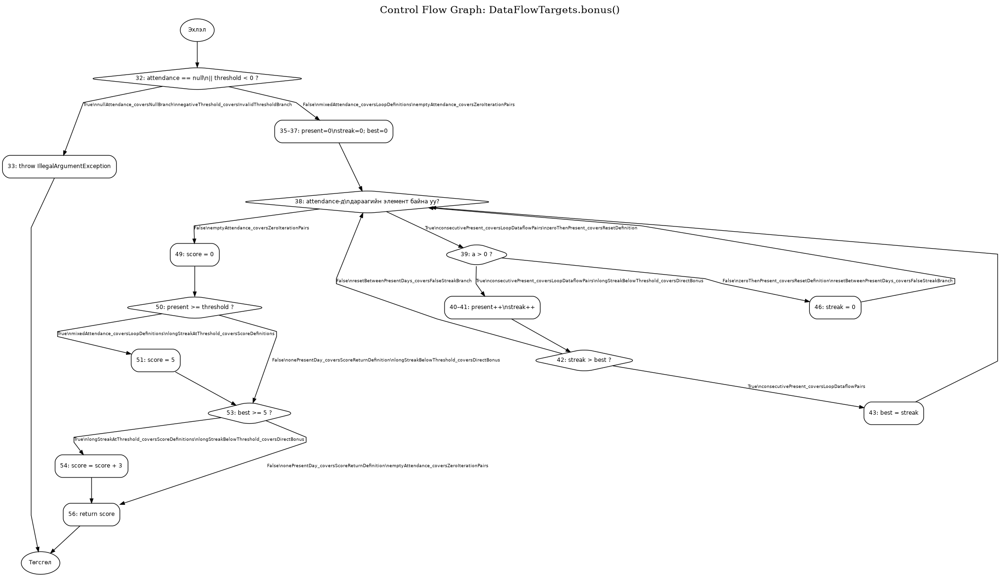

# Lab 10 — Dataflow Testing

## A хэсэг. gcd() функцийн Definition-Use анализ

### A1. Definition ба Use

`DataFlowTargets.java` файлын `gcd()` функцэд дараах тодорхойлолт (Definition) ба ашиглалт (Use) байна.

| Хувьсагч | Definition | Use | Use төрөл |
|---|---:|---:|---|
| x | 13 | 16 | c-use |
| x | 13 | 20 | c-use |
| x | 17 | 16 | c-use |
| x | 17 | 20 | c-use |
| y | 13 | 15 (True) | p-use |
| y | 13 | 15 (False) | p-use |
| y | 13 | 16 | c-use |
| y | 13 | 17 | c-use |
| y | 18 | 15 (True) | p-use |
| y | 18 | 15 (False) | p-use |
| y | 18 | 16 | c-use |
| y | 18 | 17 | c-use |
| tmp | 16 | 18 | c-use |

- c-use: хувьсагчийг тооцоолол эсвэл утга буцаахад ашиглах.
- p-use: хувьсагчийг нөхцөл шалгахад ашиглах.
- True/False: `while (y != 0)` нөхцөлийн үр дүн.

### A2. All-DU-pairs тестийн хүснэгт

| № | Хувьсагч | Def мөр | Use мөр | Төрөл | Def-clear зам | Тестийн ID |
|---:|---|---:|---:|---|---|---|
| 1 | x | 13 | 16 | c-use | 13-14-15(T)-16 | gcd_12_8_covers_loop_iteration_pairs |
| 2 | x | 13 | 20 | c-use | 13-14-15(F)-20 | gcd_7_0_covers_zero_iteration_pairs |
| 3 | x | 17 | 16 | c-use | 17-18-15(T)-16 | gcd_12_8_covers_loop_iteration_pairs |
| 4 | x | 17 | 20 | c-use | 17-18-15(F)-20 | gcd_12_8_covers_loop_iteration_pairs |
| 5 | y | 13 | 15 (T) | p-use | 13-14-15(T) | gcd_12_8_covers_loop_iteration_pairs |
| 6 | y | 13 | 15 (F) | p-use | 13-14-15(F) | gcd_7_0_covers_zero_iteration_pairs |
| 7 | y | 13 | 16 | c-use | 13-14-15(T)-16 | gcd_12_8_covers_loop_iteration_pairs |
| 8 | y | 13 | 17 | c-use | 13-14-15(T)-16-17 | gcd_12_8_covers_loop_iteration_pairs |
| 9 | y | 18 | 15 (T) | p-use | 18-19-15(T) | gcd_12_8_covers_loop_iteration_pairs |
| 10 | y | 18 | 15 (F) | p-use | 18-19-15(F) | gcd_12_8_covers_loop_iteration_pairs |
| 11 | y | 18 | 16 | c-use | 18-19-15(T)-16 | gcd_12_8_covers_loop_iteration_pairs |
| 12 | y | 18 | 17 | c-use | 18-19-15(T)-16-17 | gcd_12_8_covers_loop_iteration_pairs |
| 13 | tmp | 16 | 18 | c-use | 16-17-18 | gcd_12_8_covers_loop_iteration_pairs |

### A3. Тестийн тайлбар

**`gcd_7_0_covers_zero_iteration_pairs`**

`gcd(7, 0)` үед `while (y != 0)` нөхцөл анхнаасаа False болно. Давталт ажиллахгүй тул x-ийн 13-р мөрийн тодорхойлолт 20-р мөрийн `return x` дээр ашиглагдана. Мөн y-ийн 13-р мөрийн тодорхойлолт 15-р мөрийн False нөхцөлд ашиглагдана. Энэ нь давталтгүй замыг шалгах тест юм.

**`gcd_12_8_covers_loop_iteration_pairs`**

`gcd(12, 8)` үед Евклидийн алгоритм хоёр удаа давтагдана:

1. `x=12`, `y=8` → `tmp=4`, `x=8`, `y=4`.
2. `x=8`, `y=4` → `tmp=0`, `x=4`, `y=0`.
3. `while` нөхцөл False болж, `return 4` буцаана.

Энэ тест нь давталтын эхний болон дараагийн мөчлөгт үүсэх DU хосуудыг шалгана.

### A4. Туршилтын үр дүн

Команд: `mvn test`

- Нийт тест: 2
- Амжилттай: 2
- Алдаа: 0
- Алгассан: 0
- Үр дүн: BUILD SUCCESS

Тестийн гаралтыг `/tmp/lab10-gcd-test.txt` файлд хадгалсан.

## B хэсэг. bonus() функцийн Dataflow анализ

### B1. Control Flow Graph (CFG)

`bonus()` функцийн 32–56-р мөрийн удирдлагын урсгалыг Graphviz ашиглан дүрслэв.

Эх файл: `cfg-bonus.dot`

CFG-д дараах салааллуудыг харуулсан:
- 32-р мөр: буруу оролтыг шалгах True/False салаа.
- 38-р мөр: foreach давталтын үргэлжлэх болон дуусах салаа.
- 39-р мөр: ирцтэй болон тасалсан өдрийн салаа.
- 42-р мөр: streak нь best-ээс их эсэх.
- 50-р мөр: ирцийн тоо босго хүрсэн эсэх.
- 53-р мөр: дараалсан ирцийн урт 5 хүрсэн эсэх.

Ирмэгүүд дээр тухайн салааг хамруулах тестийн method нэрсийг тэмдэглэсэн.

### B2. Definition ба Use бүртгэл

| Хувьсагч | Definition (мөр) | Use (мөр) |
|---|---|---|
| attendance | 31 | 32 (p-use), 38 (p-use) |
| threshold | 31 | 32 (p-use), 50 (p-use) |
| present | 35, 40 | 40 (c-use), 50 (p-use) |
| streak | 36, 41, 46 | 41 (c-use), 42 (p-use), 43 (c-use) |
| best | 37, 43 | 42 (p-use), 53 (p-use) |
| a | 38 | 39 (p-use) |
| score | 49, 51, 54 | 54 (c-use), 56 (c-use) |

Тайлбар:
- Definition: хувьсагчид утга оноох үйлдэл.
- c-use: тооцоолол, илэрхийлэлд ашиглах.
- p-use: нөхцөл шалгах үед ашиглах.
- 32-р мөрийн OR нөхцөлд attendance null байвал threshold шалгагдахгүй (short-circuit).

### B3. Feasible DU-pairs

| № | Хувьсагч | Def → Use | Төрөл / салаа | Хамруулах тест |
|---:|---|---|---|---|
| 1 | attendance | 31 → 32 | p-use True | nullAttendance_coversNullBranch |
| 2 | attendance | 31 → 32 | p-use False | negativeThreshold_coversInvalidThresholdBranch |
| 3 | attendance | 31 → 38 | p-use True | consecutivePresent_coversLoopDataflowPairs |
| 4 | attendance | 31 → 38 | p-use False | emptyAttendance_coversZeroIterationPairs |
| 5 | threshold | 31 → 32 | p-use True | negativeThreshold_coversInvalidThresholdBranch |
| 6 | threshold | 31 → 32 | p-use False | consecutivePresent_coversLoopDataflowPairs |
| 7 | threshold | 31 → 50 | p-use True | emptyAttendance_coversZeroIterationPairs |
| 8 | threshold | 31 → 50 | p-use False | consecutivePresent_coversLoopDataflowPairs |
| 9 | present | 35 → 40 | c-use | consecutivePresent_coversLoopDataflowPairs |
| 10 | present | 35 → 50 | p-use | emptyAttendance_coversZeroIterationPairs |
| 11 | present | 40 → 40 | c-use | consecutivePresent_coversLoopDataflowPairs |
| 12 | present | 40 → 50 | p-use | consecutivePresent_coversLoopDataflowPairs |
| 13 | streak | 36 → 41 | c-use | consecutivePresent_coversLoopDataflowPairs |
| 14 | streak | 41 → 41 | c-use | consecutivePresent_coversLoopDataflowPairs |
| 15 | streak | 41 → 42 | p-use True | consecutivePresent_coversLoopDataflowPairs |
| 16 | streak | 41 → 42 | p-use False | resetBetweenPresentDays_coversFalseStreakBranch |
| 17 | streak | 41 → 43 | c-use | consecutivePresent_coversLoopDataflowPairs |
| 18 | streak | 46 → 41 | c-use | zeroThenPresent_coversResetDefinition |
| 19 | best | 37 → 42 | p-use True | consecutivePresent_coversLoopDataflowPairs |
| 20 | best | 37 → 53 | p-use False | emptyAttendance_coversZeroIterationPairs |
| 21 | best | 43 → 42 | p-use True | consecutivePresent_coversLoopDataflowPairs |
| 22 | best | 43 → 42 | p-use False | resetBetweenPresentDays_coversFalseStreakBranch |
| 23 | best | 43 → 53 | p-use True | longStreakBelowThreshold_coversDirectBonus |
| 24 | best | 43 → 53 | p-use False | consecutivePresent_coversLoopDataflowPairs |
| 25 | a | 38 → 39 | p-use True | consecutivePresent_coversLoopDataflowPairs |
| 26 | a | 38 → 39 | p-use False | zeroThenPresent_coversResetDefinition |
| 27 | score | 49 → 54 | c-use | longStreakBelowThreshold_coversDirectBonus |
| 28 | score | 49 → 56 | c-use | consecutivePresent_coversLoopDataflowPairs |
| 29 | score | 51 → 54 | c-use | longStreakAtThreshold_coversScoreDefinitions |
| 30 | score | 51 → 56 | c-use | emptyAttendance_coversZeroIterationPairs |
| 31 | score | 54 → 56 | c-use | longStreakAtThreshold_coversScoreDefinitions |

Нийт 31 feasible DU хосыг бүртгэв.

**Infeasible хос ба kill тайлбар:**

- `best:37 → 42 (False)` боломжгүй. Эхний эерэг ирцийн үед streak дор хаяж 1, best 0 тул нөхцөл True байна.
- 46-р мөрийн `streak = 0` нь өмнөх streak definition-ийг kill хийнэ. Дараагийн эерэг өдөр 41-р мөрийн RHS-д 0 утгыг ашигласнаар 46 → 41 хос үүснэ.
- `score:49 → 51` нь DU хос биш. 51-р мөр score-д шинэ утга оноодог тул use биш.
- 32-р мөрийн attendance null салаанд threshold шалгагдахгүй.

### B4. All-defs ба All-DU-pairs тестийн үе шат

**1-р үе шат — All-defs**

`BonusAllDefsTest.java` файлд 5 тест нэмэв. Эдгээр нь attendance, threshold, present, streak, best, a, score хувьсагчдын definition-үүдийг use-д хүргэхэд зориулагдсан.

Үр дүн:
- Нийт тест: 7 (2 GCD + 5 bonus)
- Амжилттай: 7
- Failure: 0
- Error: 0
- Build: SUCCESS

Тайлан:
- `results/mvn-verify-alldefs.txt`
- `results/jacoco-alldefs.csv`

**2-р үе шат — All-DU-pairs**

`BonusAllDUPairsTest.java` файлд 8 тест нэмж, feasible DU хосуудыг хамруулав. M2 mutation-ийн дараа нэмэлт нэг regression test оруулж, эцсийн багцыг 16 тесттэй болгосон.

Үр дүн:
- Нийт тест: 15
- Амжилттай: 15
- Failure: 0
- Error: 0
- Skipped: 0
- Build: SUCCESS

Тайлан:
- `results/mvn-test-alldu.txt`
- `results/mvn-verify-alldu.txt`
- `results/jacoco-alldu.csv`

### B5. JaCoCo үр дүнгийн харьцуулалт

| Үзүүлэлт | All-defs | All-DU-pairs |
|---|---:|---:|
| Тестийн тоо | 7 | 15 |
| Branch covered | 16 | 16 |
| Branch missed | 0 | 0 |
| Branch coverage | 100% | 100% |
| Line covered | 23 | 23 |
| Line missed | 1 | 1 |

JaCoCo-ийн branch coverage хоёр үе шатанд 100% хэвээр байна. Line coverage 23/24 буюу 95.83% байна. Хамрагдаагүй мөр нь implicit constructor-той холбоотой.

Branch coverage 100% байх нь бүх DU хос хамрагдсан гэсэн үг биш. JaCoCo branch болон line coverage-ийг хэмждэг бол DU-pair coverage-ийг тусад нь кодын Definition-Use шинжилгээгээр үнэлнэ.

## C хэсэг. Mutation Testing

Mutation testing ашиглан тестийн багц зориудаар өөрчилсөн кодын алдааг илрүүлж чадаж байгаа эсэхийг шалгав. Туршилт бүрийн дараа `DataFlowTargets.java` файлыг анхны хувилбараар сэргээсэн.

### C1. M1 — streak нэмэгдүүлэх үйлдлийг устгах

`streak = streak + 1;` мөрийг түр устгаж тест ажиллуулав.

Үр дүн:
- Нийт тест: 15
- Failure: 3
- Илрүүлсэн тестүүд:
  - `longStreakBelowThreshold_coversDirectBonus`
  - `longStreakAtThreshold_coversScoreDefinitions`
  - `longStreak_coversScoreAdditionDefinition`
- Жишээ: expected 3, actual 0.
- Mutation: KILLED.

Тестүүд дараалсан ирцийн тоолуур ажиллахаа больсныг илрүүлсэн.

Үр дүн: `results/mvn-test-M1.txt`

### C2. M2 — best хувьсагчид буруу утга оноох

`best = streak;` мөрийг түр хугацаанд `best = present;` болгон өөрчилж шалгав.

Эхний туршилтаар:
- Нийт тест: 15
- Failure: 0
- Build: SUCCESS
- Mutation: SURVIVED.

Энэ нь анхны тестийн багц нийт ирсэн өдөр болон хамгийн урт дараалсан ирцийн ялгааг илрүүлэхгүй байгааг харуулсан.

Үүнийг илрүүлэхийн тулд `bestUsesLongestStreakNotTotalPresentDays` тест нэмэв. Оролт нь `[1, 1, 0, 1, 1, 1, 1]`, threshold нь 7. Зөв үр дүн 0 боловч mutation хийсэн код 3 гэж буруу буцаасан.

Нэмэлт тестийн үр дүн:
- Expected: 0
- Actual: 3
- Failure: 1
- Mutation: KILLED.

Эх кодыг сэргээсний дараа нийт 16 тест бүгд амжилттай болсон.

Үр дүн:
- `results/mvn-test-M2.txt`
- `results/mvn-test-M2-kill.txt`
- `results/mvn-test-after-M2.txt`

### C3. M3 — ашиглагдаагүй хувьсагч нэмэх

`int total = present + best;` гэсэн ашиглагдаагүй хувьсагчийг түр нэмэв.

Үр дүн:
- Нийт тест: 16
- Failure: 0
- Build: SUCCESS
- Mutation: SURVIVED.

VS Code-ийн Problems хэсэгт “No problems have been detected in the workspace” гэж гарсан. Иймээс IDE-ийн шалгалтаар ашиглагдаагүй хувьсагчийн анхааруулга илрээгүй.

Үр дүн: `results/mvn-test-M3.txt`

### C4. Эх кодыг сэргээж баталгаажуулах

Mutation туршилтуудын дараа `DataFlowTargets.java` файлыг нөөцөлсөн эх хувилбараар сэргээсэн.

Эцсийн SHA256:

`3f25edc00462f8ef1aa9de821481c9fd19f0931623b604af5f92cce3aaf2a955`

Энэ хэш нь эхний туршилтын өмнө авсан хэштэй ижил. Git diff шалгалтаар эх кодод өөрчлөлт үлдээгүй.

### C5. Эцсийн clean verify ба JaCoCo

`mvn clean verify` командыг амжилттай ажиллуулав.

- Нийт тест: 16
- Амжилттай: 16
- Failure: 0
- Error: 0
- Skipped: 0
- Build: SUCCESS
- Branch coverage: 16/16 буюу 100%.
- Line coverage: 23/24 буюу 95.83%.

Хамрагдаагүй нэг мөр нь implicit constructor-той холбоотой.

Тайлан:
- `results/mvn-verify-final.txt`
- `results/jacoco-final.csv`

### C6. Туршилтын орчин

Java болон Maven-ийн хувилбарын дэлгэрэнгүй гаралтыг дараах файлд хадгалсан:
- `results/java-version.txt`
- `results/maven-version.txt`

Ашигласан орчин: Debian Linux, OpenJDK 21.0.12.1, Apache Maven 3.9.9.

## Дүгнэлт

Энэ лабораторийн ажлаар Definition-Use шинжилгээ ашиглан gcd() болон bonus() функцийн өгөгдлийн урсгалыг судаллаа. gcd() функцийн DU хосуудыг тестээр хамруулсан. bonus() функцийн хувьд 31 feasible DU хосыг тодорхойлж, All-defs болон All-DU-pairs тестүүдийг үе шаттай хэрэгжүүлэв. Эцсийн тестийн багц 16 тесттэй бөгөөд бүгд амжилттай ажилласан. JaCoCo-ийн branch coverage 100%, line coverage 95.83% гарсан. Mutation testing-ээр M1 болон M2 алдааг илрүүлсэн боловч M3 тест болон IDE-ийн шалгалтаар илрээгүй. Иймээс өндөр branch coverage нь бүх төрлийн өгөгдлийн урсгалын алдааг илрүүлнэ гэсэн баталгаа биш гэдгийг ойлголоо.

## AI ашигласан тухай

Лабораторийн ажлын явцад AI-г Definition-Use хосын шинжилгээ, тестийн тохиолдол боловсруулах, Maven болон JaCoCo-ийн үр дүнг тайлбарлах, README баримтжуулалтыг боловсруулахад туслах хэрэгсэл болгон ашигласан. Командуудыг Debian орчинд ажиллуулж, үр дүнг өөрөө шалган баталгаажуулсан.
